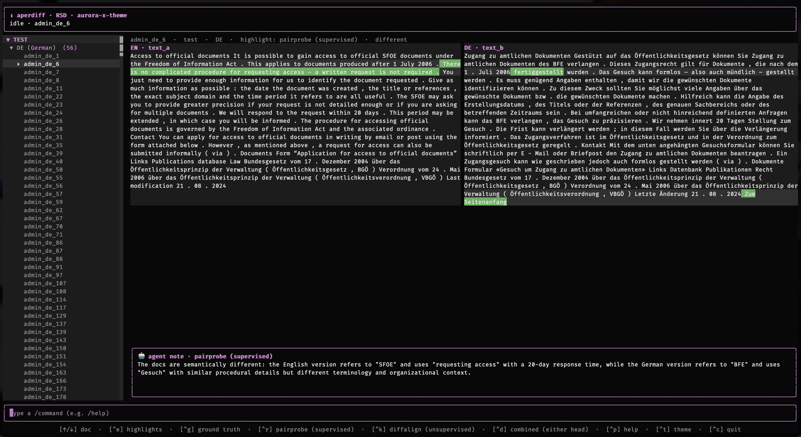
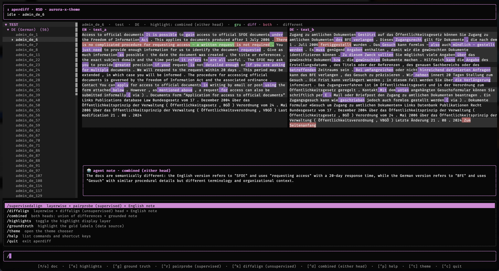

# Aperdiff — Beating SwissGov-RSD benchmarks by more than 1.5x using frozen Apertus-1.5-8B

We perform Cross-lingual **Recognition of Semantic Differences (RSD)** over Swiss government documents, built on a **frozen** [`swiss-ai/Apertus-v1.5-8B`](https://huggingface.co/swiss-ai/Apertus-v1.5-8B) residual stream and a light trained probe. It ships as a self-contained TUI + headless CLI whose only dependency is a container runtime.

> **HackApertus — Track 2A (Academia):** *Detecting Cross-Lingual Semantic
> Differences in Swiss Government Websites* (UZH).

Our results are present in our [Technical Report](technical_report.md)

## Local + CPU-only Inference

- **CPU-only.** No GPU, no CUDA, no Metal. ~5–6 GB RAM, SIMD-optimized for ARM (Apple Silicon / ARM Linux); x86-64 works but is slower. Read build/make instructions for details.
- **Text-only.** We use the text-only checkpoint and credit [`andreasmartin/apertus-v1.5-8b-text`](https://huggingface.co/andreasmartin/apertus-v1.5-8b-text)
- **GGUF for local inference.**  We convert this to mixed bit quantized GGUF and upload to our HF personal account [`justacoderwhocodes/apertus-1.5-text-only`](https://huggingface.co/justacoderwhocodes/apertus-1.5-text-only)


## Interactive Terminal User Interface

The TUI lets you *touch and feel* the predictions by browsing the 224 document pairs per language, running both the unsupervised and supervised methods to verify our claims, in a transparent manner, against the ground truth. We also provide agent annotation, that explains why the model chose a specific difference.

**Supervised pair-probe head** (`ctrl+r`) — per-word (whitespace bound) difference scores from the trained GRU probe, with a grounded English note:



**Combined head** (`ctrl+d`) — the union of the supervised and unsupervised (DiffAlign) signals, to provide the entire signal:



NOTE: The default view is the ground truth from human annotations, and switching using a `/ command` or `ctrl+shortcut` re-runs inference from scratch to provide the final annotated words.

## Quickstart

Run a single command from the repository root:

```bash
make run
```

`make run` pulls the published multi-arch image and prints the **bundled results** table. In order to re-run an inference on the spot (with progress bar), simply use one of the comments below

| Invocation                                                   | Explanation                                                                                                                                                                                                              |
|--------------------------------------------------------------|--------------------------------------------------------------------------------------------------------------------------------------------------------------------------------------------------------------------------|
| `make run`                                                   | Shows the bundled results in a table, use JSON=1 to output as JSON                                                                                                                                                       |
| `make run MODE=predict HEAD=unsupervised LANG=it TEST=1`     | Choose a language and rerun predictions on test SwissGov set, only HEAD is required and by default it runs over the entire set unless TEST = 1 is specified. LANG filters the languages it is run on and can be omitted. |
| `make run MODE=predict INPUT=custom.jsonl OUTPUT=out JSON=1` | Predict over a custom json file instead of SwissGov                                                                                                                                                                      |
| `make run MODE=results LANG=de JSON=1`                       | Show bundled results for a particular language and in JSON                                                                                                                                                               |
| `make run MODE=tui`                                          | Run the interactive Terminal User Interface                                                                                                                                                                              |
| `make run MODE=smoke SMOKE_FAST=1`                           | Just a quick test to see if everything is working correctly                                                                                                                                                              |
| `make run MODE=speedtest`                                    | Benchmarks your system for TTFT, tok/s and prefill tok/s (anything above 10 tok/s and 30 prefill tok/s is quite usable, I tested at 16 tok/s and 60 prefill on Macbook Pro)                                              |


### Parameters listed out: 
- `IMAGE` (default `ghcr.io/bitanath/rsd-swissgov:latest`)
- `PLATFORM` (choose linux/arm64 to benefit from all our SIMD optimizations, or linux/amd64 as a fallback), 
- `MODE` (choose either predict or results or tui as explained above)
- `HEAD` (choose supervised or unsupervised to re-run the predictions using that method)
- `LANG` (choose de or fr or it to see results or predict on that language )
- `INPUT` (predict over an arbitrary jsonl file in a similar text_a/text_b format to the SwissGov dataset)
- `OUTPUT` (write outputs to an arbtirary file)
- `TEST` (splits by SwissGov test dataset for either mode `predict` or `results`)
- `JSON` (output in json format not as a table)
- `SMOKE_FAST` (just a quick test to ensure everything works on your system)
- `ARGS` (any other args for testing etc)

`LLM_NAME` / `LLM_BASE_URL` / `LLM_API_KEY` are not used and irrelevant here.

The `results` / `predict` tables carry the paper's token-level metrics **per document** — `spearman` and `kendall` (τ-b) against the gold labels, pooled over both texts with gold `-1` dropped.

### Sample raw Docker commands in case the Makefile does not work as expected

```bash
docker run --rm -it --detach-keys="" -e TERM=xterm-256color ghcr.io/bitanath/rsd-swissgov:latest # interactive very beautiful and nice TUI

docker run --rm -v "$PWD:/data" ghcr.io/bitanath/rsd-swissgov:latest predict --output predictions # reproduce the full-set predictions (supervised head) -> ./predictions.jsonl

docker run --rm -v "$PWD:/data" ghcr.io/bitanath/rsd-swissgov:latest predict --input custom.jsonl --output outputs # predict an arbitrary jsonl ({id,text_a,text_b}; gold labels optional)

docker run --rm -v "$PWD:/data" ghcr.io/bitanath/rsd-swissgov:latest predict --input custom.jsonl --head unsupervised --output outputs # unsupervised head (DiffAlign)


docker run --rm -v "$PWD:/data" ghcr.io/bitanath/rsd-swissgov:latest predict --lang de,fr --output outputs # restrict languages and output to file outputs.jsonl
docker run --rm -v "$PWD:/data" ghcr.io/bitanath/rsd-swissgov:latest predict --test --output outputs # restrict to test split only


docker run --rm ghcr.io/bitanath/rsd-swissgov:latest results # precomputed predictions (the numbers in our technical report)
docker run --rm ghcr.io/bitanath/rsd-swissgov:latest results --lang it # precomputed predictions only for Italian (the numbers in our technical report)

docker run --rm ghcr.io/bitanath/rsd-swissgov:latest --smoke
docker run --rm ghcr.io/bitanath/rsd-swissgov:latest --speedtest

```

## Repository layout

| Path                                             | What it is                                                   |
|--------------------------------------------------|--------------------------------------------------------------|
| `README.md`                                      | this file — build, run, and results                          |
| `technical_report.md`                            | the write-up: architecture, data, evaluation, ablation       |
| `Makefile`                                        | `make run` and friends                                       |
| `Dockerfile`                                      | multi-stage build (app + engine libs + GGUF)                 |
| `track_2a/src/app/`                              | the OpenTUI (Bun/TypeScript) application: TUI + headless CLI |
| `track_2a/src/python/`                           | training / ablation / judging scripts and checkpoints        |
| `track_2a/src/libelthur-*.so`, `libelthur.dylib` | prebuilt CPU engine libraries                                |
| `track_2a/data/`                                 | the SwissGov-RSD pairs and the bundled predictions           |
| `track_2a/docs/`                                 | screenshots and diagrams                                     |
| `track_2a/README.md`                             | code-level details                                           |


## Results in Brief

SwissGov-RSD **test** split (56 docs/lang), token-level **Spearman ×100**, gold `-1` dropped. Full table and the paper comparison are in
[`technical_report.md`](technical_report.md).

|                                             System |    EN–DE |    EN–FR |    EN–IT |    macro |
| -------------------------------------------------: | -------: | -------: | -------: | -------: |
|             DiffAlign · Apertus L15 (unsupervised) |     32.2 |     18.2 |     36.0 |     28.8 |
|      DiffAlign · Apertus L14–17 sum (unsupervised) |     31.5 |     18.4 |     36.6 |     28.8 |
| **Pair probe · Apertus L14–17 → GRU (supervised)** | **44.1** | **27.2** | **47.3** | **39.5** |
|                Human annotator agreement (ceiling) |     56.1 |     43.6 |     65.1 |     54.9 |


## Build from scratch

This is a complex process and ideally should not be attempted. It is also meant for MacOS Apple Silicon Pro archs, and I have not had time or energy to adapt it to different archs, ymmv. The image is built from a **multi-stage** `Dockerfile` at the repository root, which basically compiles Bun/OpenTUI app is against a prebuilt engine library (`track_2a/src/libelthur-*.so`) written in Zig to expose model internals, the Apertus GGUF is fetched from Hugging Face, and the runtime points the engine at it via `ELTHUR_MODEL`. 

_Elthur is my library (fire in Icelandic), based on my previous work Logi (which means flame in Icelandic). Lore is orthogonal to the submission and doesn't change it in any way._

```bash
make build                 # build for the host architecture -> aperdiff:local
make run IMAGE=aperdiff:local
make push                  # multi-arch (linux/amd64 + linux/arm64) build & push to GHCR or wherever (will need creds)
```

> The `Dockerfile` is written so that
> every `RUN` executes on the **build** platform and the target stages are
> `COPY`-only — no QEMU emulation is required.

## Hardware & performance

Host = Apple Silicon, Apertus 1.5 8B Q5_K_M: **~16 tok/s decode**, **~63 tok/s prefill** (in-container ~12.5 / ~48). The first launch is slower while the OS validates the binary. `--speedtest` reports the live numbers and flags an underpowered machine.


## License

Apache-2.0 (code) matching the submission template this repo is forked from. The SwissGov-RSD labels are released under CC BY; the copyright of the underlying `admin.ch` text remains with the Swiss federal authorities.
