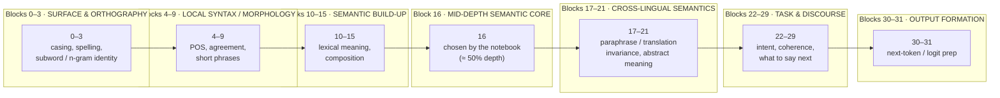

# Code details (Track 2A)

The below is an AI generated summary of the code directory that holds the source of the submission. 
The build/run instructions and the results live in the repository-root [`README.md`](../README.md); the write-up
is in [`technical_report.md`](../technical_report.md).

## Layout

```
src/
├── app/                 Bun + OpenTUI (TypeScript) application
│   ├── index.tsx        entry point: speedtest → smoke → results/predict → TUI
│   └── src/
│       ├── terminalexec.ts   headless CLI: `results` / `predict`
│       ├── smoke.ts          --smoke self-check
│       ├── speedtest.ts      --speedtest throughput probe
│       ├── funcs.ts          bun:ffi bindings to the engine (libelthur)
│       ├── interface/        TUI screens (doc browser, pair view, notes)
│       └── libraries/
│           ├── clit/         headless helpers: analyze, dataset, metrics
│           ├── hunk/         vendored diff/rendering layer (OpenTUI)
│           └── progress/     worker-based per-token progress
├── python/              training / ablation / judging (PyTorch)
│   ├── probationists.py      pair-probe architectures + ablation + training
│   ├── ablation.py           training-free 32-layer readout
│   ├── judging.py            SwissGov-RSD harness replication
│   ├── diffalign.py          unsupervised DiffAlign head
│   ├── export.py             bake artifacts: gru.bin + swissgov.json(l)
│   ├── layerwise/            checkpoints (*.pth) 
│   └── dataset/              SwissGov + iSTS datasets in jsonl
├── libelthur-arm64.so   prebuilt CPU engine (Linux arm64)
├── libelthur-amd64.so   prebuilt CPU engine (Linux amd64)
└── libelthur.dylib      prebuilt CPU engine (macOS arm64)
```

## Apertus layer bands - Illustrative only

A general mental model of how a decoder spreads work (surface → syntax → semantics → task → output). The names are heuristic; the signal peaks in the *Semantic build-up*
band (layers 14–17).



Apertus is a dense transformer, not an MoE: every block encodes information about the input tokens. We distill the intermediate representations of its multilingual understanding (the L14–17 band) to give the pair-probe a strong, stable signal.


## Engine libraries

`libelthur-*.so` / `libelthur.dylib` are the compiled CPU engine from a language called Zig. 
They are shipped prebuilt so the app can be compiled without a Zig toolchain. 
The Docker build stages the matching library as `app/libelthur.bin` before `bun build --compile`.

## Python pipeline
Use the python pipeline to replicate ablation and export data for the TUI. 

```bash
python -m venv .venv && . .venv/bin/activate && pip install -r python/requirements.txt

python python/ablation.py --split val --limit 20 --calib-frac 0.35 --out ablation_devsel.json
python python/judging.py --system probe --tag devsel --arch gru
python python/export.py            # -> track_2a/src/app/src/data/swissgov.json(l)
```

Feature caches (`python/layerwise/*_L14..17.pt`) are large and are **not** checked in; regenerate them with the capture scripts before training (if needed).
