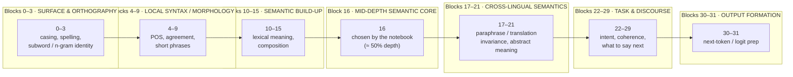

# Apertus layer bands

A general mental model of how a decoder spreads work (surface → syntax →
semantics → task → output). The names are heuristic; the
[32-layer ablation](../technical_report.md#61-intermediate-layer-ablation-vs-human-agreement)
is what turns them into evidence — the signal peaks in the *Semantic build-up*
band (layers 14–17).

Apertus is a dense transformer, not an MoE: every block encodes information about
the input tokens. We distill the intermediate representations of its multilingual
understanding (the L14–17 band) to give the pair-probe a strong, stable signal.
