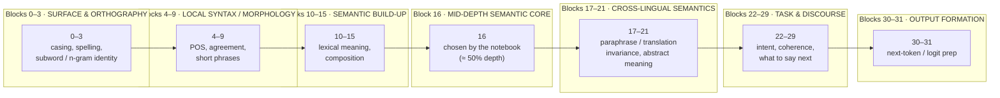

# Apertus layer ablation — which layer is the strongest signal for Semantic Diff

In order to train a probe, we need an initial strong signal (versus ground truth)
This can only be computed by measuring intermediate layers for correlations
Once the intermediate layer is decided, we train an actual parametric probe 
This forms a nonlinear scoring mechanism for individual and overall tokens from different languages.
Based on whether they are semantically similar or different to each other.

## Spearman Correlations using different techniques (from the paper)

Wastl, Vamvas & Sennrich (ACL 2026), Table 3 — SwissGov-RSD columns. Token-level Spearman
with gold labels (values as reported in the paper, ×100). ★ = best overall on SwissGov-RSD.
`DE/FR/IT %` = each score as a percentage of that language's human-annotator agreement
(e.g. `20.6 / 56.1 = 36.7%`); the best ratio is bolded.

| Technique                      | Type              | EN–DE    | EN–FR    | EN–IT    | DE %  | FR %  | IT %     |
|--------------------------------|-------------------|--:-------|--:-------|--:-------|--:----|--:----|--:-------|
| DiffAlign · LaBSE ★            | unsupervised      | 20.6     | 8.2      | **25.6** | 36.7  | 18.8  | **39.3** |
| DiffAlign · XLM-R+SimCSE       | unsupervised      | 19.2     | 10.0     | 23.4     | 34.2  | 22.9  | 35.9     |
| DiffAlign · Qwen3-Embedding 4B | unsupervised      | 20.1     | 11.2     | 20.3     | 35.8  | 25.7  | 31.2     |
| DiffAlign · EuroBERT 610M      | unsupervised      | 18.6     | 11.4     | 18.7     | 33.2  | 26.1  | 28.7     |
| DiffAlign · bge-m3             | unsupervised      | 14.8     | 9.9      | 13.6     | 26.4  | 22.7  | 20.9     |
| GPT-4o                         | few-shot          | 4.2      | 1.2      | 5.5      | 7.5   | 2.8   | 8.4      |
| GPT-4o-mini                    | fine-tuned (iSTS)  | 3.9      | 1.1      | 5.3      | 7.0   | 2.5   | 8.1      |
| ModernBERT-large (EN-IT*)      | fine-tuned (iSTS)  | 7.5      | 4.8      | 12.4     | 13.4  | 11.0  | 19.0     |
| **Human annotator agreement**  | practical ceiling | **56.1** | **43.6** | **65.1** | 100.0 | 100.0 | 100.0    |


**Best on SwissGov-RSD: 25.6 (LaBSE DiffAlign, EN–IT).** The paper's point is the
*generalization gap*: the same systems score ~45–82 on the synthetic iSTS-RSD but only
~0–26 here. Note all paper numbers on SwissGov-RSD are **zero-shot / transferred from
iSTS-RSD** (DiffAlign is unsupervised; the fine-tuned encoders/LLMs train on synthetic data,
not on SwissGov), so our in-domain probe (see the ablation table below) is not directly
comparable — the fair reference is the human ceiling ratio that we computed.


## The 32 blocks, with friendly (heuristic) names

> The names below are a *general* mental model of how decoder LLMs spread work
> (surface → syntax → semantics → task → output). They are **not** measured specifically for
> Apertus; the ablation table is what turns them into evidence.



NOTE: Apertus is a dense transformer, not an MoE, and every layer encodes information
about the input tokens, to be used in generating the output. Effectively we distill intermediate
representations of the model's multilingual understanding to ensure an effective probe.

## Ablation Method (no probe training)

`ablation.py` computes, for every block, a **closed-form / training-free** readout
of how well the block's features encode the human token-level difference labels
(all languages: de + fr + it, ground truth `labels_a`/`labels_b`):

1. Capture site `res_ffn` for **all 32 blocks in a single prefill** (per side), for
   each pair, and mean-pool token vectors to whitespace words.
2. Estimate two directions on a **calibration slice** (`--calib-frac`, default 0.35):
   * **OLS** — `d ∝ Cov(x, y)` (closed-form least squares; the "probe without the
     Transformer"), aimed at the **continuous** label → reported `Spearman ρ (OLS)`.
   * **DoM** — difference of class means `μ(gold≥0.5) − μ(gold≤0.05)`, aimed at the
     **binary** same/different split → reported `ρ (DoM)`, `AUC`, `Sep`.
3. Score the held-out pairs as `s = x·d` and report per block:
   * `Spearman ρ (OLS)` — rank correlation with the gold score (the metric the real
     probe is judged on) → **primary**.
   * `Pearson r (OLS)`, `ρ (DoM)`, `AUC (DoM)` (same vs different), `Sep`
     (standardised projection gap), and per-language `ρ de/fr/it`.

## Word Align method and Innovation for final classification

Two inferences of Apertus per pair. Because Apertus is causal — a token only sees what's *before* it — you can't get both cross-contexts in one pass.

- **Pass 1 = `[B][A]`** (German then English) → English tokens sit *after* German, so they attend to it → keep the English rows = `feats_a` (English sees German).
- **Pass 2 = `[A][B]`** (English then German) → German tokens sit *after* English → keep the German rows = `feats_b` (German sees English).

In `[A][B]` alone the English tokens are first, so they'd only see themselves (useless); the German tokens would see English. In `[B][A]` it's the reverse. So you need **both orders** to get each side's vector with the other language in context.

> Cost note: that is 2× a single prefill. We added a capture-only early exit (`model_capture_stop`) that breaks the layer loop at L15 → ~2× faster capture while producing **bit-identical** L15 vectors. Text generation is unaffected.

### For Example
One EN–DE pair (`admin_de_1`):

```
Apertus (frozen):     feats_a (305, 4096)   [English, sees German]
                      feats_b (250, 4096)   [German,  sees English]
concat:               X      (555, 4096)    # English 0..304, German 305..554
seg:                  seg    (555,)         # 305 zeros, then 250 ones (which text)
pad:                  pad    (555,)  bool   # padding mask (batch)
                      |
proj (4096->512):     (555, 512)
+ seg embed:          (555, 512)
transformer (4L,8H):  (555, 512)            # attention across BOTH texts
head (512->128->1):   (555, 1) -> (555,)
sigmoid:              (555,)                # one 0-1 score per token
```

Output = 555 scores: `[0:305]` English tokens, `[305:555]` German tokens. `seg`/`pad` are bookkeeping we know from how the pair was built — nothing predicted, nothing from labels.

## Simplified Understanding

The idea in one picture:

```
English text ──Apertus (frozen)──► per-token vectors  (n_EN, 4096)
German  text ──Apertus (frozen)──► per-token vectors  (n_DE, 4096)
                      |  concatenate [English ; German]  + seg marker (0/1)
                      v
              small transformer  (cross-attention over both texts)
                      |
              per-token head  ──►  one 0–1 difference score per token
```

- **Apertus stays frozen**; only the small transformer ("pair probe") is trained.
- Because both texts sit in **one sequence**, every German token can attend to the English tokens (and vice versa) — so the model can *compare* the two languages. Scoring each side separately cannot do this; that is the whole point of the pair probe.


## Current results

| method                                                  | EN–DE      | EN–FR      | EN–IT      |
|---------------------------------------------------------|--:---------|--:---------|--:---------|
| DiffAlign · Apertus L15 (unsupervised)                  | 32.2       | 18.2       | 36.0       |
| DiffAlign · Apertus L14–17 sum (unsupervised)           | 31.5       | 18.4       | 36.6       |
| **Pair probe · GRU (frozen Apertus L14–17, in-domain)** | **46.2**   | **27.3**   | **50.1**   |
| Human annotator agreement (ceiling)                     | 56.1       | 43.6       | 65.1       |
| _OOD · synthetic target↔target_                         | 21.7 de-fr | 19.2 de-it | 15.1 fr-it |


*Values are token-level Spearman ×100, pooled over both texts. Pair probe = **bidirectional GRU** (final arch), single seed, best val epoch (ep5). Arch sweep (val macro / OOD macro, best-epoch): **GRU 41.2 / 18.7**, CNN 41.0 / 18.2, MLP 39.3 / 19.1, transformer 39.1 / 19.1, xattn 38.9 / 20.0, bilinear 39.2 / 17.4 — **GRU** chosen (best in-domain macro, best DE/IT; OOD within noise of CNN); FR is the only arch-sensitive language and is annotation-limited. Last row's columns are the target↔target pairs **de-fr / de-it / fr-it**, not EN–XX. DiffAlign L14–17 fusion does **not** beat L15 (mean 28.84 vs 28.81).*


## Ablation table for intermediate Layers compared against Human Agreement

Run: `python ablation.py --split full --limit 15 --calib-frac 0.35`
(45 pairs; ★ = best `Spearman ρ (OLS)`, ◆ = best `AUC (DoM)`)

**Result:** the signal is strongest at **layer 15** (ρ = 0.289, AUC = 0.754) — the top of the
*Semantic build-up* band — and plateaus across roughly **layers 13–17**. 

| Layer  | Heuristic name            | Spearman ρ (OLS) | Pearson r (OLS) | ρ (DoM) | AUC (DoM) | Sep   | ρ de   | ρ fr   | ρ it   | n     |
|--:-----|---------------------------|--:---------------|--:--------------|--:------|--:--------|--:----|--:-----|--:-----|--:-----|--:----|
| 0      | Surface & orthography     | 0.1046           | 0.1126          | 0.0837  | 0.6034    | 0.345 | 0.0594 | 0.1006 | 0.0786 | 26116 |
| 1      | Surface & orthography     | 0.0928           | 0.1097          | 0.0639  | 0.5925    | 0.313 | 0.0468 | 0.0942 | 0.0660 | 26116 |
| 2      | Surface & orthography     | 0.0779           | 0.0989          | 0.0362  | 0.5740    | 0.256 | 0.0345 | 0.0914 | 0.0523 | 26116 |
| 3      | Surface & orthography     | 0.0647           | 0.0862          | 0.0265  | 0.5667    | 0.231 | 0.0249 | 0.0758 | 0.0450 | 26116 |
| 4      | Local syntax / morphology | 0.0527           | 0.0745          | 0.0204  | 0.5638    | 0.218 | 0.0165 | 0.0666 | 0.0338 | 26116 |
| 5      | Local syntax / morphology | 0.0794           | 0.1001          | 0.0310  | 0.5745    | 0.256 | 0.0418 | 0.0788 | 0.0787 | 26116 |
| 6      | Local syntax / morphology | 0.0626           | 0.0785          | 0.0247  | 0.5684    | 0.235 | 0.0394 | 0.0697 | 0.0577 | 26116 |
| 7      | Local syntax / morphology | 0.0744           | 0.0952          | 0.0368  | 0.5813    | 0.276 | 0.0521 | 0.0778 | 0.0790 | 26116 |
| 8      | Local syntax / morphology | 0.1069           | 0.1338          | 0.0610  | 0.6043    | 0.354 | 0.0930 | 0.1019 | 0.1238 | 26116 |
| 9      | Local syntax / morphology | 0.1909           | 0.2157          | 0.1245  | 0.6614    | 0.551 | 0.1655 | 0.1803 | 0.2233 | 26116 |
| 10     | Semantic build-up         | 0.1929           | 0.2184          | 0.1183  | 0.6557    | 0.534 | 0.1638 | 0.1806 | 0.2256 | 26116 |
| 11     | Semantic build-up         | 0.2305           | 0.2619          | 0.1477  | 0.6830    | 0.629 | 0.1995 | 0.2179 | 0.2645 | 26116 |
| 12     | Semantic build-up         | 0.2291           | 0.2704          | 0.1396  | 0.6765    | 0.602 | 0.2041 | 0.2255 | 0.2560 | 26116 |
| 13     | Semantic build-up         | 0.2632           | 0.3068          | 0.1937  | 0.7226    | 0.770 | 0.2304 | 0.2621 | 0.2947 | 26116 |
| 14     | Semantic build-up         | 0.2661           | 0.3101          | 0.2064  | 0.7304    | 0.808 | 0.2304 | 0.2731 | 0.2929 | 26116 |
| 15 ★ ◆ | Semantic build-up         | 0.2886           | 0.3654          | 0.2359  | 0.7539    | 0.918 | 0.2573 | 0.2961 | 0.3050 | 26116 |
| 16     | Mid-depth semantic core   | 0.2700           | 0.3386          | 0.2177  | 0.7384    | 0.843 | 0.2422 | 0.2846 | 0.2839 | 26116 |
| 17     | Cross-lingual semantics   | 0.2765           | 0.3394          | 0.2301  | 0.7460    | 0.880 | 0.2458 | 0.2793 | 0.2842 | 26116 |
| 18     | Cross-lingual semantics   | 0.2546           | 0.3135          | 0.2179  | 0.7355    | 0.845 | 0.2278 | 0.2658 | 0.2506 | 26116 |
| 19     | Cross-lingual semantics   | 0.2612           | 0.3164          | 0.2240  | 0.7386    | 0.861 | 0.2380 | 0.2656 | 0.2603 | 26116 |
| 20     | Cross-lingual semantics   | 0.2528           | 0.3138          | 0.2157  | 0.7347    | 0.845 | 0.2301 | 0.2592 | 0.2455 | 26116 |
| 21     | Cross-lingual semantics   | 0.2519           | 0.3134          | 0.1972  | 0.7211    | 0.787 | 0.2265 | 0.2501 | 0.2473 | 26116 |
| 22     | Task & discourse          | 0.2232           | 0.2730          | 0.2099  | 0.7264    | 0.823 | 0.1991 | 0.2356 | 0.2083 | 26116 |
| 23     | Task & discourse          | 0.2241           | 0.2695          | 0.2080  | 0.7225    | 0.816 | 0.1998 | 0.2258 | 0.2069 | 26116 |
| 24     | Task & discourse          | 0.2094           | 0.2498          | 0.1917  | 0.7085    | 0.763 | 0.1837 | 0.2117 | 0.1770 | 26116 |
| 25     | Task & discourse          | 0.2101           | 0.2555          | 0.1760  | 0.6982    | 0.718 | 0.1810 | 0.2127 | 0.1742 | 26116 |
| 26     | Task & discourse          | 0.1957           | 0.2330          | 0.1589  | 0.6797    | 0.655 | 0.1632 | 0.2012 | 0.1458 | 26116 |
| 27     | Task & discourse          | 0.1805           | 0.2090          | 0.1567  | 0.6700    | 0.627 | 0.1280 | 0.1935 | 0.1360 | 26116 |
| 28     | Task & discourse          | 0.1803           | 0.2061          | 0.1549  | 0.6690    | 0.619 | 0.1290 | 0.1982 | 0.1383 | 26116 |
| 29     | Task & discourse          | 0.1786           | 0.2049          | 0.1493  | 0.6636    | 0.600 | 0.1374 | 0.1975 | 0.1354 | 26116 |
| 30     | Output formation          | 0.1794           | 0.1970          | 0.1565  | 0.6676    | 0.602 | 0.1457 | 0.2038 | 0.1280 | 26116 |
| 31     | Output formation          | 0.1038           | 0.1317          | 0.0664  | 0.5833    | 0.326 | 0.0548 | 0.1112 | 0.0469 | 26116 |


## How to read it

* We look for where `Spearman ρ (OLS)` (and `AUC`) peaks like a local minima — that band is
  the candidate region for the real probe.
* Cross-lingual stability matters for RSD: we prefer a band where `ρ de`, `ρ fr`,
  `ρ it` agree in sign and magnitude rather than one language dominating.
* The chosen `LAYER` is one that makes the probe's life easier, i.e. by giving a clear
  signal to the parametric classifier we ensure a distinct output as well